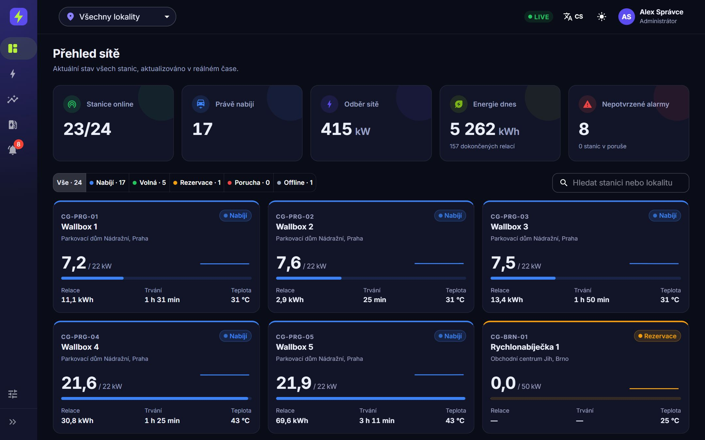
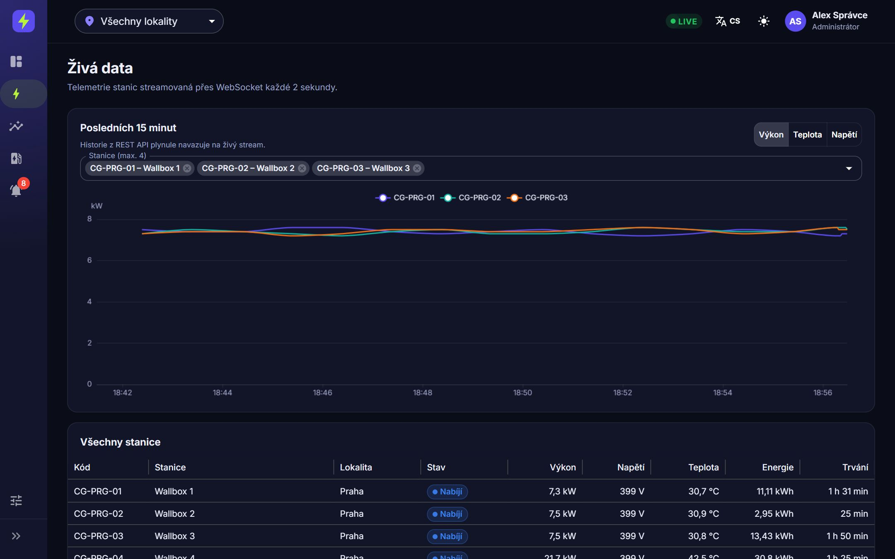
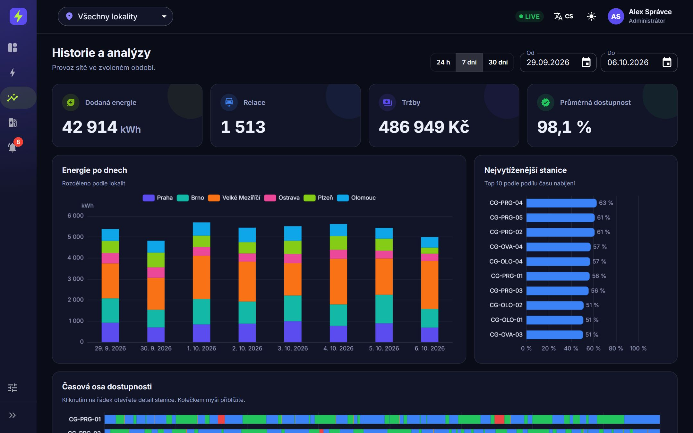
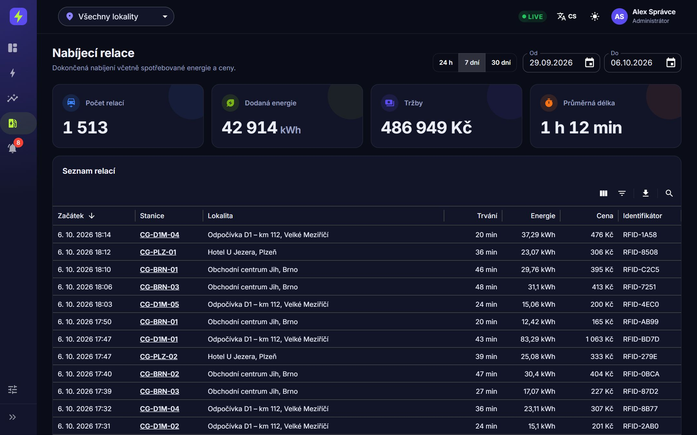
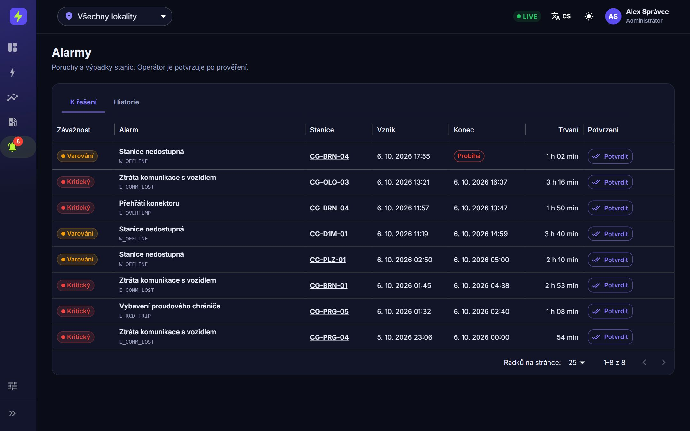
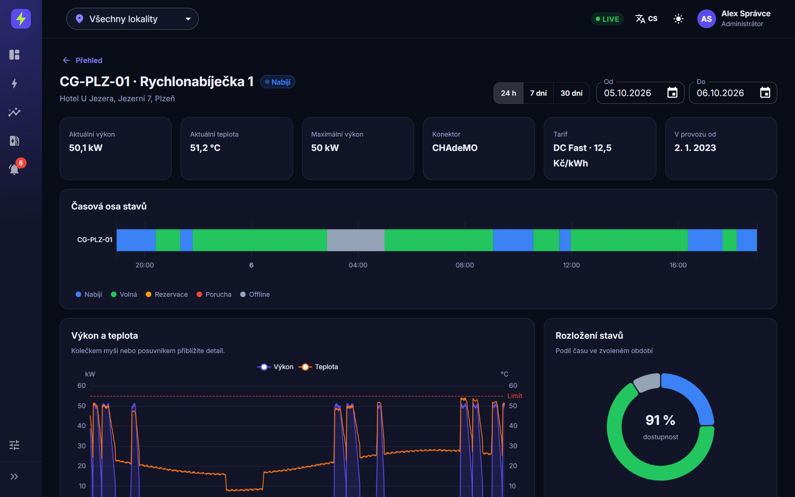
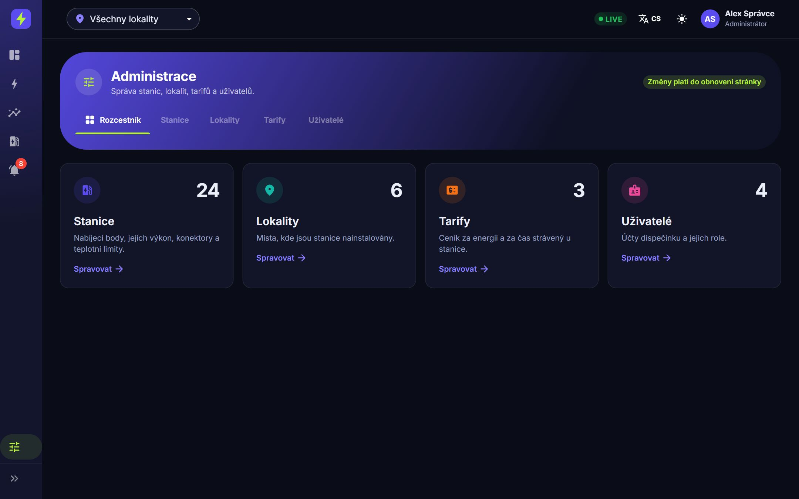

<div align="center">

# ⚡ No More Tears

### Elektrifikujeme Česko. Bez slz u nabíječky.

Prezentační web demo startupu, který staví síť nabíjecích stanic pro elektromobily
a&nbsp;provozuje nad ní dispečink **Charge Grid**.

[](https://chargegrid.bartosdev.cz/)




</div>

---

## 💡 O projektu

Rozbitá nabíječka. Aplikace, která tvrdí, že je volno. Tři různé karty v&nbsp;peněžence.
**No More Tears** je fiktivní startup, který tyhle slzy řeší — buduje celorepublikovou síť
rychlonabíjecích stanic a&nbsp;nad ní jeden datový mozek: **Charge Grid**.

Tento repozitář obsahuje **landing page** startupu. Dispečink Charge Grid, na který web odkazuje,
je samostatná a&nbsp;**skutečně funkční aplikace** — můžete si ji [vyzkoušet naživo](https://chargegrid.bartosdev.cz/).

> 🧪 Jde o&nbsp;demo projekt. Firma, čísla, recenze i&nbsp;kontaktní údaje na webu jsou smyšlené.
> Skutečný je kód, design a&nbsp;aplikace Charge Grid.

## 🔌 Charge Grid — živé demo

Na **[chargegrid.bartosdev.cz](https://chargegrid.bartosdev.cz/)** se přihlaste jedním z&nbsp;demo účtů
a&nbsp;uvidíte, jak se aplikace mění podle role:

| Účet | Co může |
| --- | --- |
| **Administrátor** | spravuje stanice, lokality, tarify a&nbsp;uživatele |
| **Operátor** | sleduje provoz a&nbsp;potvrzuje alarmy |
| **Čtenář** | pouze prohlíží |

Heslo je stejné jako uživatelské jméno — na přihlašovací obrazovce stačí účet vybrat.
Data jsou generovaná přímo v&nbsp;prohlížeči.

<table>
  <tr>
    <td width="50%"><br><sub><b>⚡ Živá data</b> — výkon, teplota a napětí přes WebSocket každé 2 s</sub></td>
    <td width="50%"><br><sub><b>📊 Historie</b> — energie, relace, tržby a dostupnost za období</sub></td>
  </tr>
  <tr>
    <td><br><sub><b>🔌 Relace</b> — každé nabíjení s energií, cenou a RFID, s exportem</sub></td>
    <td><br><sub><b>🔔 Alarmy</b> — přehřátí, proudový chránič, ztráta komunikace</sub></td>
  </tr>
  <tr>
    <td><br><sub><b>📍 Detail stanice</b> — časová osa stavů a teplotní limit</sub></td>
    <td><br><sub><b>⚙️ Administrace</b> — stanice, lokality, tarify a uživatelé</sub></td>
  </tr>
</table>

Aplikace dále podporuje **češtinu i&nbsp;angličtinu** a&nbsp;**světlý i&nbsp;tmavý režim**.

## ✨ Co umí landing page

- **Animovaný hero** — interaktivní částicová síť na `<canvas>`, která reaguje na kurzor, a&nbsp;živě se měnící metriky sítě se sparkline grafem
- **Interaktivní prohlídka produktu** — okno „prohlížeče" s&nbsp;přepínáním obrazovek Charge Grid, měnící se URL a&nbsp;popisky
- **Mapa nabíječek v&nbsp;ČR** — SVG mapa se stanicemi, vyhledáváním podle města, filtry (volné / 150+&nbsp;kW) a&nbsp;tooltipem s&nbsp;detailem
- **Přepínač „Pro řidiče / Pro servis"** s&nbsp;animovaným mockupem telefonu a&nbsp;servisního tiketu
- **Počítadla statistik**, scroll-reveal animace, roadmapa, tým a&nbsp;FAQ akordeon
- **Kontaktní formulář** s&nbsp;validací na straně klienta
- **Responzivní design** s&nbsp;mobilním menu, přístupné prvky (ARIA role, ovládání klávesnicí)

## 🛠️ Technologie

Žádný framework, žádný build, žádné závislosti — čisté **HTML, CSS a&nbsp;JavaScript**.

- **CSS** — custom properties, Grid & Flexbox, gradientní typografie, glassmorphism, animace
- **JavaScript** — Canvas 2D API, dynamicky generované SVG, `IntersectionObserver`, `requestAnimationFrame`
- **Fonty** — [Inter](https://fonts.google.com/specimen/Inter) a&nbsp;[Space Grotesk](https://fonts.google.com/specimen/Space+Grotesk)

## 🚀 Spuštění

```bash
git clone https://github.com/BartosStore/no-more-tears.git
cd no-more-tears
```

Pak stačí otevřít `index.html` v&nbsp;prohlížeči. Případně spustit jednoduchý lokální server:

```bash
npx serve .
# nebo
python -m http.server 8000
```

## 📁 Struktura

```
no-more-tears/
├── index.html            # obsah stránky
├── style.css             # design systém a styly
├── script.js             # animace, mapa, prohlídka produktu, formulář
└── img/chargegrid/       # screenshoty aplikace Charge Grid
```

## 👤 Autor

**Ing. Miroslav Bartoš** — návrh a&nbsp;vývoj

Líbí se vám projekt? Budu rád za zpětnou vazbu.

[](mailto:bartos.store@gmail.com)
[](https://www.linkedin.com/in/miroslav-barto%C5%A1-6a197b185)

<div align="center">
<sub>⚡ No More Tears · Charge Grid™ · Elektrifikujeme Česko.</sub>
</div>
